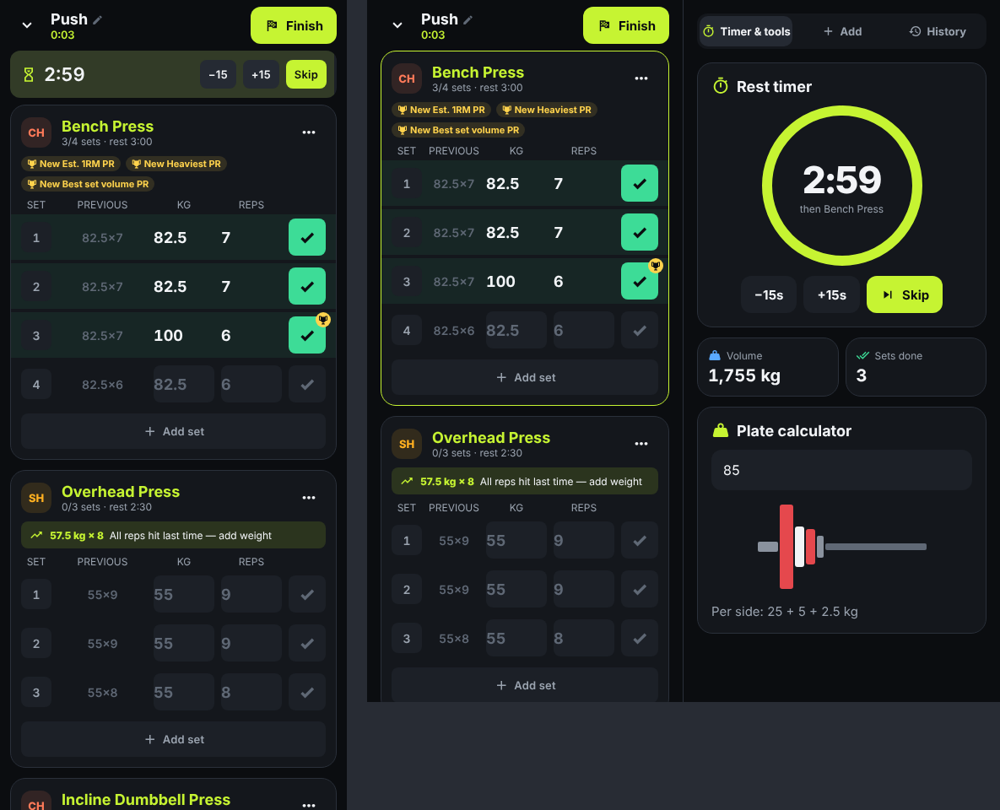
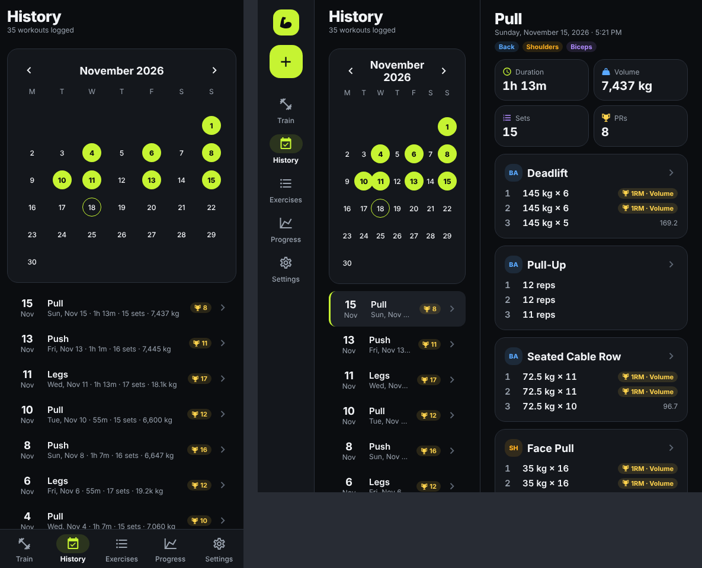

# Ironfold

A strength-training tracker built with Expo for Android, designed around the **Samsung Galaxy Z Fold**: a fast one-handed logger on the cover screen and a two-pane workspace on the inner screen.



## What's inside

Ironfold takes the best-loved features from today's leading gym apps:

| Feature | Inspired by |
| --- | --- |
| Set-by-set logger with a **"Previous" column** and your last numbers as placeholders: tap ✓ to repeat them | Strong |
| **Auto rest timer** after every working set, ±15 s, skip, and a notification when rest ends with the phone folded or locked | Strong / Hevy |
| **Live PR detection** (est. 1RM, heaviest weight, best set volume, most reps) with trophies and haptics | Hevy |
| **Progressive overload hints**: "All reps hit last time — 57.5 kg × 8" | Fitbod |
| **Muscle recovery** status from the last 72 h of training | Fitbod |
| Routines with sets / reps / rest per exercise, plus starter Push-Pull-Legs and Full Body routines | Hevy / Strong |
| Supersets, warm-up ramp generator, set types (warm-up, drop, failure), per-exercise notes | Strong / Hevy |
| Plate calculator (kg and lb) | Strong |
| **How-to demos**: real gym photos of each machine/lift, looping between start and end position like a GIF, plus step-by-step instructions (bundled, work offline) | Hevy / JEFIT |
| Exercise library (~100 lifts) with search, muscle filters, custom exercises, and per-exercise charts and history | JEFIT |
| History calendar, weekly goal ring and streak, weekly volume, top-lift 1RM trends, body-weight log | Hevy / Strong |

All data stays on the device (AsyncStorage). In **Settings → Load 10 weeks of sample data** you can try every chart right away.

## Built for the Fold

| | Cover screen (folded, ~411 dp wide, 21:9) | Inner screen (unfolded, ~750 × 830 dp) |
| --- | --- | --- |
| Navigation | Bottom navigation bar | Navigation rail on the left, with a Start/Resume button |
| Train | Single column | Routines on the left, routine editor or recovery on the right |
| Active workout | Full-screen logger with a sticky rest bar | **Logger on the left half, live tools on the right half**: large rest ring, plate calculator pre-filled with the next set, the "Add exercise" library, or the focused exercise's chart and history |
| History / Exercises | List, tap to open the detail | List and detail side by side |
| Progress / Settings | Stacked cards | Two-column grid |



Details:

- **The pane divider sits on the hinge.** In portrait on the inner screen, list and detail split at the crease (see `useLayout().listPane`), so no input straddles the fold.
- **Continuity when you fold or unfold.** The layout depends only on window width (Material 3 window size classes: below 600 dp is compact, 600 dp and up is two-pane). The navigator and all state live above that switch, so folding the phone mid-set keeps your workout, tab and timer exactly where they were. Expo's Android activity handles size changes without restarting.
- **Rotation is unlocked** (`orientation: "default"`), so the inner screen works in portrait and landscape.
- Large touch targets (44 dp or more) and a dark, high-contrast theme for sweaty gym use. The screen stays on during a workout.

## Run it

```bash
npm install
npx expo start            # press "a" for a connected Android device / emulator, or "w" for web
```

Expo Go works for most of the UI. For background rest notifications, use a real build.

### Install on your Fold (APK)

```bash
npx eas-cli@latest login
npm run build:apk         # EAS "preview" profile → downloadable .apk
```

Open the link EAS prints on your phone, and install the APK. For a local build instead, run `npx expo run:android` with Android Studio installed.

## Credits

Exercise photos and instructions come from [Free Exercise DB](https://github.com/yuhonas/free-exercise-db), released into the public domain under the Unlicense.

## Project layout

```
src/
  app/                 Expo Router routes
    (tabs)/_layout.tsx adaptive shell: bottom bar ↔ navigation rail
    (tabs)/*.tsx       Train, History, Exercises, Progress, Settings
    workout.tsx        active workout (single pane ↔ split pane)
    exercise/[id], session/[id], routine/[id], pick-exercise
  components/          logger, charts (react-native-svg), tools, two-pane, UI kit
  lib/                 store (zustand + persist), stats (1RM, PRs, overload, recovery), data
  theme/               colours and the Fold-aware useLayout() hook
```

Checks: `npm run typecheck` and `npm run lint`.
